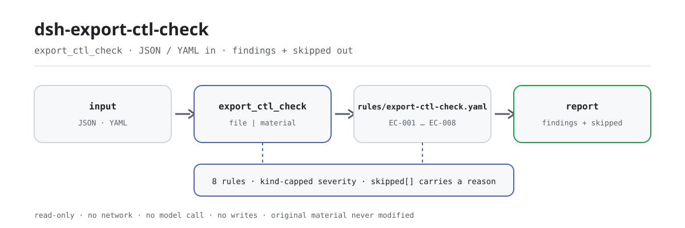

<div align="center">

<picture>
  <source media="(prefers-color-scheme: dark)" srcset="docs/assets/dsh-export-ctl-check-flow-dark.svg">
  
</picture>

# dsh-export-ctl-check

**把一份出口管制物项台账逐行核到「哪一行、哪一栏、差什么」——只列差异，不下结论。**

面向关务合规与出口管制岗的离线核对插件：读一份台账（出口经营者表头 + 每行一条物项），按版本化规则包核对台账自身的齐备与闭环；不联网、不调用模型、不改原件。

[安装](#三步上手) · [配置](#配置) · [FAQ](#faq) · [简体中文](README.md) · [English](README.en.md) · [Español](README.es.md) · [Português](README.pt.md) · [हिन्दी](README.hi.md)

[](LICENSE)
[](#兼容性)
[](https://www.npmjs.com/package/dsh-export-ctl-check)
[](https://github.com/PerryLink/dsh-export-ctl-check/actions/workflows/ci.yml)
[](#兼容性)

[](https://github.com/PerryLink/dsh-export-ctl-check/stargazers)
[](https://www.npmjs.com/package/dsh-export-ctl-check)
[](https://dshfind.com/plugins/PerryLink/dsh-export-ctl-check?ref=badge)
[](https://securityscorecards.dev/viewer/?uri=github.com/PerryLink/dsh-export-ctl-check)
[](https://dsh.market/)
[](https://gitee.com/perrylink/dsh-export-ctl-check)

```sh
dsh plugin --profile <name> add dsh-export-ctl-check
```

</div>

<sub>社区插件，与 DeepSeek 官方无关。唯一仓库：<https://github.com/PerryLink/dsh-export-ctl-check>（Gitee 为镜像）。</sub>

## 它是什么

`dsh-export-ctl-check` 读取一份出口管制物项台账——出口经营者表头加每条物项一行——核对的是这份台账自身的齐备与闭环，而不是对物项本身作出判断：每条物项是否在「是否受控」栏写明是否受控、标为受控的物项是否填写了出口许可证号、填了许可证号的是否写明了发证日期、最终用途或最终用户是否至少填写了一项、最终目的地是否填写、许可证号是否在同一份台账内重复、管制类别是否取用本机构自己的取值、物项名称栏是否残留【】、XXX、待填、TBD、示例之类未替换的占位符。

它只列出材料内部可以逐条指认的差异，并逐条给出「哪一行、哪一栏、差什么、补什么」；不判定物项是否受控、是否需要许可，也不判定某项出口是否合规。在对话里把材料交给它即可，安装只需一条命令，核对结果直接读。33 个测试（`npx vitest run`）覆盖 8 条规则的成对夹具，`samples/quickstart` 可以离线跑通一次真实核对。

## 三步上手

1. **安装**（三选一）：

   ```sh
   # git 通道（最新 main）
   dsh plugin --profile web add github:PerryLink/dsh-export-ctl-check
   # npm 通道（已发布版本）
   dsh plugin --profile web add dsh-export-ctl-check
   # tarball 通道：本仓库 pnpm pack 后
   dsh plugin --profile web add ./dsh-export-ctl-check-<version>.tgz
   ```

   无运行时依赖；`lib/index.mjs` 与 `rules/` 即发布产物。

2. **最小配置**（默认即可用；规则包随包发布）：

   ```yaml
   - insert:
       - id: dsh-export-ctl-check
         name: dsh-export-ctl-check
   ```

3. **验证已生效**：

   ```sh
   dsh --profile web --dump-config | grep 'dsh-export-ctl-check'
   node samples/quickstart/run.mjs
   ```

   ```text
   $ node samples/quickstart/run.mjs
   export_ctl_check: 1 issue(s) — error 0, warn 1, info 0
   skipped: 2
   ```

**卸载**：`dsh plugin --profile web remove dsh-export-ctl-check`（或从 profile patch 删掉该行）。

> 插件不联网、不写材料文件，所有核对都在本地完成。样例在 `samples/quickstart/input/`，期望输出在 `samples/quickstart/expected/result.json`；也可以在 WorkBuddy / 扣子搜「关务合规核对包」（本检查是其中一项，上架以商城为准）。

## 核心能力

`export_ctl_check` 只有一个工具面：读材料、跑规则包、回一份报告。能力按「你能拿它做什么」列：

- **八条规则一次跑完** —— `EC-001` 到 `EC-008` 覆盖受控声明、许可证号、发证日期、最终用途与最终用户、最终目的地、许可证号重复、管制类别取值、名称占位符；每条只核对「填了没有／在不在册」，不核对「填得对不对」。
- **定位到行与栏** —— 每条发现都带 `locator`（`row` + `field`）、`found`、`expected` 与 `fix`，可以直接回到台账的那一格修改。
- **跳过要说原因** —— 无法执行的检查进 `skipped` 并写明原因；空的问题清单不等于「没问题」，规则未配置或材料缺列都不会被静默当成通过。
- **规则是数据** —— 规则库 `rules/export-ctl-check.yaml` 与代码分离，替换文件即可切换规则集版本，无需改 TypeScript；加载期校验每条规则的 `document` / `number` / `clause` / `excerpt` / `kind` / `source`。
- **引用不伪造** —— 摘录必须是逐字引文；依据只是原则性条款时 `kind` 记为 `derived-from-principle` 且严重级封顶 `warn`，本机构配置的阈值封顶 `info`。
- **纯离线** —— 无网络请求、不调用模型、不写台账文件；工具只返回文本报告（`markdown`）与结构化报告（`reportJson`）。

### 规则表

| 规则 | 检查什么 | 严重级 | 依据类型 |
|---|---|---|---|
| `EC-001` | 每条物项都标明是否受控 | `warn` | 原则推导 |
| `EC-002` | 标为受控的物项填写出口许可证号 | `warn` | 直接规定 |
| `EC-003` | 填了许可证号的物项写出发证日期 | `warn` | 原则推导 |
| `EC-004` | 最终用途与最终用户至少填写一项 | `warn` | 直接规定 |
| `EC-005` | 每条物项填写最终目的地 | `warn` | 直接规定 |
| `EC-006` | 许可证号在同一份台账内不重复 | `warn` | 原则推导 |
| `EC-007` | 管制类别取自本机构配置的取值 | `info` | 原则推导 |
| `EC-008` | 物项名称不残留未替换的占位符 | `warn` | 直接规定 |

### 示例

下面是本插件对自己 `EC-001` 测试夹具的真实输出，不是示意图。

**工具** `export_ctl_check`

**输入**

~~~json
{"rows":[{"物项名称":"某型高性能传感器","是否受控":""}]}
~~~

**输出**

~~~json
{
  "id": "dsh-export-ctl-check.EC-001.de09b5a6",
  "ruleId": "EC-001",
  "severity": "warn",
  "locator": {
    "field": "controlled",
    "row": 1
  },
  "found": "第 1 行「controlled」为空",
  "expected": "「controlled」应填写",
  "fix": "补填是否受控；本条只核对是否声明，不判断该判断是否正确"
}
~~~

*Observed from `tests/fixtures/EC-001/EC-001-unsafe.json (cases.json expects EC-001 count 1); run via lib/index.mjs rules/export-ctl-check.yaml`*

### 你会问，它怎么答

| 你会问 | 它怎么答 |
|---|---|
| 物项标为受控却没填许可证号，会被报出吗？ | 会，`EC-002` 报出这个缺口：某一行的「是否受控」取值属于本条配置为受控的那些值（出厂为 `是`、`Y`、`yes`、`true`、`受控`、`√`）时，它就要求填写出口许可证号。本条只核对证号栏是否填写，不判断该许可证是否真实、是否仍在有效期内、是否覆盖该物项与该目的地。台账若用别的写法表示受控，请把该写法加入本条的判定取值，否则该行会被当作非受控而不报——本插件不持有管制清单，无从替你判断。 |
| 物项已标明是否受控，但最终用途与最终用户两栏都空着，会被发现吗？ | 会，`EC-004` 报出该行：它要求这两栏至少填写一项。填了一项即算通过，本条也不判断所填用途与用户是否真实、是否属于法律禁止或限制的情形。 |
| 许可证号填了，发证日期栏却空着，算问题吗？ | `EC-003` 要求填写。条件是许可证号本身：没有证号的行不会被要求填日期。本条不核对许可证的有效期，也不拿发证日期与出口日期作比较——它只确认日期填了，不判断日期是否在前。 |
| 同一个许可证号出现在好几行上，会怎么说？ | `EC-006` 按重复报出该证号。它分不清「一份许可证覆盖多个物项」（台账常见写法）与「抄错了号」，所以命中需要人工确认；本条不会替你改号，也不给出同一个许可证号最多能出现在几行。若本机构台账本就是「一证多物项」，请为同一许可证的各行加上序号区分，或停用本条。 |
| 某行的最终目的地栏是空的。 | `EC-005` 报出该行，因为每条物项都要填写目的地。它只核对这一栏是否填写，不判断该目的地是否被允许：某国家或地区是否属于禁运或受限制，要看主管部门公布的名单，本插件不内置任何国家名单。 |
| 物项名称栏还写着 `【示例】` 或 `XXX`，算缺陷还是算真实名称？ | 名称里出现本条要找的词时，`EC-008` 报出该行——这些词是 `【`、`】`、`{{`、`}}`、`XXX`、`xxx`、`待填`、`待补充`、`TBD`、`todo`、`示例`。这份词表跟随本机构自己的模板，可以调整。本条只看这一栏里有没有这些词，不判断名称本身填得对不对。 |

## 配置

全部可调参数都在 `src/config.ts` 的 Schemastery schema 中，改 `cordis.yml` 即生效，无需改代码；逐条规则的阈值在 `rules/` 的规则库文件里。

| 键 | 类型 | 默认值 | 说明 |
|---|---|---|---|
| `rulesFile` | string | `rules/export-ctl-check.yaml` | 规则库文件路径，相对插件包根目录 |
| `disabledRules` | string[] | `[]` | 要停用的规则 id 列表；每条都会出现在 `skipped` 中 |
| `onlyRules` | string[] | `[]` | 只执行这些规则 id；留空表示执行全部规则 |
| `skipNotes` | string | `""` | 附加到每条 `skipped` 说明后的备注 |
| `timeoutMs` | number | `120000` | 工具协作式超时预算（毫秒） |

<details>
<summary>规则级参数（写在规则库里，不在这里配置）</summary>

- `EC-002` `conditionValues` —— 哪些「是否受控」取值算受控，出厂为 `[是, Y, yes, true, 受控, √]`；台账若用别的写法，加进这个列表，否则该行按非受控处理、本条不报。
- `EC-007` `values` —— 本机构的管制类别取值，例如 `[核, 导弹, 生物, 化学, 军民两用]`；出厂为空 = 未配置，本条进 `skipped`，插件不内置任何分类体系。
- `EC-008` `terms` —— 占位符词表，出厂为 `【`、`】`、`{{`、`}}`、`XXX`、`xxx`、`待填`、`待补充`、`TBD`、`todo`、`示例`。

</details>

profile patch 覆盖示例：

```yaml
- insert:
    - id: dsh-export-ctl-check
      name: dsh-export-ctl-check
      config:
        onlyRules: [EC-001, EC-002, EC-003]
        skipNotes: 本机构实施细则 2026 版
```

## 材料格式

工具接受 JSON 或 YAML。工具参数二选一：`file`（材料文件绝对路径）或 `material`（内联材料文本）。Excel 可先转成 JSON/YAML，对话里也能代转。

```yaml
exporter: 某某进出口有限公司
contractNo: SC-2026-018
listVersion: 2026 年版
rows:
  - { 序号: '1', 物项名称: 某型高性能传感器, 商品编号: '9031809090',
      管制类别: 军民两用, 最终用途: 用于工业自动化产线的位移测量,
      最终用户: 某某工业自动化有限公司, 最终目的地: 德国,
      许可证号: EX2026-0018, 许可日期: 2026-02-25, 是否受控: 是 }
```

列名匹配忽略大小写、空格、下划线与连字符；报告沿用台账自己的列名，因此每条发现都能指回它读的那一栏。字段在读取层是可选的，由检查引擎校验，所以部分导出的材料会产生「缺项」类差异，而不是让程序崩溃。

## 依据的标准

| 文件 | 文号 | 引用它的规则 |
|---|---|---|
| 《中华人民共和国出口管制法》 | 2020 年 10 月 17 日第十三届全国人大常委会第二十二次会议通过，主席令第五十八号公布，自 2020 年 12 月 1 日起施行 | EC-001, EC-002, EC-003, EC-004, EC-005, EC-006, EC-008 |
| 《中华人民共和国出口管制法》 | 现行版本本次未核实 | EC-007 |

**边界：** 本插件核对一份 **出口管制物项台账** 在台账层面可以要求到的闭环——每条物项是否写明是否受控，标为受控的物项是否填写许可证号，填写许可证号的是否写明发证日期，是否记录最终用途或最终用户，是否记录最终目的地，许可证号是否不重复，管制类别是否取自你配置的取值口径，以及是否残留占位符。它**不**判定物项是否受控、是否需要许可证，也不判定某项出口是否会违反规定。

### 规则库

规则数据在 `rules/export-ctl-check.yaml`。文件头写明：本插件不持有管制清单、不做清单查询，因此发现不了「该申报受控却没申报」。加载期仍要求每条规则写全 document / clause / excerpt / source，并禁止把原则推导或本机构配置的检查标为 `error`。

> ### ⚠️ 在采信报告中的引文之前，请先读这一段
>
> **每条 `excerpt` 的状态逐条不同，不是统一的。** 有的规则引用逐字条文（`kind: direct`），有的按条文原则推导（`kind: derived-from-principle`，最高 `warn`），有的阈值由本机构配置（`kind: institutional-configuration`，最高 `info`）。规则包从不概括引文：取不到原文时，`excerpt` 会如实写明，推理写在 `note` 里；并有测试断言没有任何规则声称拥有它并不拥有的引文。**对仍标为「未取得原文」的规则，取得文本后必须把 `excerpt` 换成真实条款，并把 `kind` 提升为 `direct`。**
>
> 结论性判断留给审核人：本插件只列出材料内部可以逐条指认的差异，不判断事实真伪，也不评价合规性。

## FAQ

<details>
<summary>材料会被上传或联网处理吗？</summary>

不会。插件只读你通过 `file` 或 `material` 交给它的内容，在本地解析、本地跑规则：没有网络请求、没有遥测、不调用模型。结果只出现在工具返回值与 DSH 宿主自己的会话日志里，包本身不另存一份。

</details>

<details>
<summary>我怀疑某条物项该受控却没报，是不是漏了？</summary>

这是本插件最重要的能力边界，不是漏报：它不内置管制清单，也不把商品编号或技术参数映射到清单条目，因此发现不了「该申报受控却没申报」。是否受控要由出口经营者对照主管部门公布的清单判断。插件能保证的是：无法执行的检查会写进 `skipped`，不会静默通过。

</details>

<details>
<summary>会和别的插件抢命令名、事件或 slot 吗？</summary>

不会。它只声明 `tools` 依赖、只注册一个 `export_ctl_check` 工具；不注册命令、不注册客户端 slot、不注册 `webServer` 前缀、不提供 service key、不改全局对象。逐条论证见「互操作性」。

</details>

<details>
<summary>性能开销多大？</summary>

本地解析加规则匹配，无网络、无模型调用；默认工具超时预算 `120000` 毫秒。33 个测试（`npx vitest run`）覆盖 8 条规则的成对夹具，`samples/quickstart` 可离线复跑。

</details>

<details>
<summary>规则包能换吗？</summary>

能。`rulesFile` 可指向任意规则库文件（相对包根或绝对路径）；规则是数据，加载期会校验引用字段与严重级封顶。替换文件即可切换规则集版本，不用改 TypeScript。

</details>

## 安全边界

- **只读材料。** 插件通过 `file` 或 `material` 读取内容，不写回、不改原件；唯一的写操作是 DSH 宿主自己记录的会话日志，包不加第二份副本。
- **不联网、不调用模型。** 无网络请求、无遥测、无模型调用；核对完全在本地完成。
- **不作出定性结论。** 报告只列材料与所引条款之间的字面差异，不判定合规、责任或事实真伪；结论留给审核人。
- **失败不静默。** 规则库加载期校验；无法执行的检查进 `skipped` 并写明原因，空的问题清单不会被读成「没有问题」。
- **不伪造引用。** 摘录必须是逐字引文；取不到原文就如实写明，并在严重级上封顶。
- **注册即 effect。** 工具注册返回 disposer，停用或热重载会注销工具，不留下悬挂监听。

## 已知限制

- **不内置管制清单。** 「是否受控」栏是台账自己的声明；插件只核对声明之后的闭环，发现不了「应申报受控却未申报」。这是本插件最重要的能力边界。
- **不判断许可证本身。** `EC-002`、`EC-003` 只核对证号与发证日期是否填写，不验证许可证真伪、有效期，也不比较发证日期与出口日期。
- **不判断最终用途与最终用户真实性。** `EC-004` 只要求两栏至少填写一项，不判断所填内容是否真实、是否属于法律禁止或限制的情形。
- **不判断目的地是否受限。** `EC-005` 只核对最终目的地栏是否填写，不内置任何国家或地区名单。
- **`EC-006` 的重复是线索不是结论。** 一份许可证覆盖多个物项是常见写法，命中需要人工确认；插件不改号，也不规定一份许可证最多覆盖几行。
- **`EC-007` 需要你给取值。** `values` 出厂为空，未配置时本条进 `skipped`；管制类别的分法随清单版本变化，插件不硬编码分类体系。
- **引用状态逐条不同。** 部分规则的 `excerpt` 仍标「未取得原文」，`kind` 保持 `derived-from-principle` 且封顶 `warn`；取得文本后应换成真实条款并升为 `direct`。
- **全量规则仍是 8 条。** 覆盖的是台账层面的齐备与闭环，不是对物项、许可证或交易的实质审查。

## 互操作性

本插件只注册一个工具，不占用其他插件的表面：

- **只声明 `tools` 依赖。** `inject = ['tools']`；没有 tools 服务时不会注册工具。
- **只注册 `export_ctl_check`。** 不注册命令、不注册客户端 slot、不注册 `webServer` 前缀，因此不参与相应的座位争抢。
- **不提供 service key，不改全局对象。** 不 patch 原型、不写 `process.env`、不替换全局 fetch。
- **bundle patch 只 insert 自己一行。** `cordis.patch.yml` 只新增本插件行，不覆写内置行的 `config`。
- **共享件随包复制。** `src/shared/` 是复制进包的共享套件，不依赖其他插件的运行时代码。
- **工具注册是 effect。** `apply()` 返回 disposer，停用或热重载会干净注销。

## 兼容性

| 项目 | 状态 |
|---|---|
| Harness | 对等版本范围 `>=0.1.2-rc.1 <0.2.0 \|\| >=0.2.0-0 <0.3.0` —— 已实测同时接受 `0.2.0-rc.2` 与 `0.2.1-rc.2`。**已声明 `engines.dsh`**：0.2.1 起由宿主单独裁决，范围为 `>=0.2.1-0 <0.3.0` |
| Node | `^22.19.0 \|\| >=24.0.0` |
| 平台 | 全平台（纯 ESM；无原生代码、无联网、不调用模型） |
| 工具模式 | `native` / `ptc` 均可；整批校验整个目录时建议 `ptc`，schema 成本只付一次 |

## 排错

- **插件装上了但工具不出现**：确认 `main` 指向 `lib/index.mjs` 且 `pnpm run build` 已生成该文件；`main` 写错会让加载器静默跳过该条目。
- **`dsh plugin add` 报版本不兼容**：peer 范围覆盖 `0.1.x` 与 `0.2.x`；若运行时在其之外，可显式豁免：`dsh plugin --profile <name> allow-version dsh-export-ctl-check@0.1.0 --dsh-version <runtime> --accept-risk`。
- **某项我觉得受控却没报**：本插件不持有管制清单，请自行对照公布的清单确认；见「已知限制」。
- **`EC-002` 对我确信不受控的物项报出**：该行「是否受控」栏写了受控取值，改栏或补许可证号，插件读的是声明不是货物。
- **`EC-006` 对一证多物项报出**：为同一许可证的各行加序号区分，或停用本条。
- **`EC-005` 不知道哪些目的地受限**：它只核对目的地栏是否填写，国家名单刻意不内置。
- **某条规则没有执行**：查看 `skipped` 数组，其中写明了规则 id 与原因。
- **`check` 报 `manifest-peers` 失败**：静态检查器比对的是一份早于 0.2 世代的硬编码 peer 范围；安装期的 peer 校验以运行时为准。这是 `dsh-plugin-dev` 的已知上游问题。
- **时间看起来偏移**：全部计算都是对输入字符串做墙上时钟运算，不做时区换算。

## 生态与质量

- [Gitee 镜像](https://gitee.com/perrylink/dsh-export-ctl-check)（同步镜像，以 GitHub 为准）
- [dshfind 插件页](https://dshfind.com/plugins/PerryLink/dsh-export-ctl-check)（安装量与排名）
- [OpenSSF Scorecard 报告](https://securityscorecards.dev/viewer/?uri=github.com/PerryLink/dsh-export-ctl-check)（由 [.github/workflows/scorecard.yml](.github/workflows/scorecard.yml) 驱动）
- [DSH Market](https://dsh.market/)（已上架）
- [按材料选核查器](https://perrylink.github.io/zh/checkers/choose/)（62 个核查器与通用插件的选型索引）

## 开发

```sh
pnpm install
pnpm run typecheck   # tsc --noEmit
pnpm test            # vitest，共享表格套件 + 成对夹具
pnpm run build       # tsdown -> lib/index.mjs + lib/index.d.mts
pnpm run check:readmes
node ../scripts/sync-shared.mjs dsh-export-ctl-check
```

数据型插件：`src/model.ts` 声明表格形状，`src/shared/` 的共享套件提供读取与检查引擎，规则库声明每一条检查。最后一条命令把 `../_shared` 的共享件同步进 `src/shared/`，每次改动共享件后都要重跑。配图由 [`scripts/gen-readme-assets.py`](scripts/gen-readme-assets.py) 程序化生成（Python + Pillow，输出深浅双版 SVG），可重复执行。

Topics：`dsh`, `dsh-plugin`, `deepseek-harness`, `cordis`, `export`, `ctl`

## 家族与致谢

本项目是 [PerryLink](https://github.com/PerryLink) 维护的 DeepSeek Harness 插件家族成员（全部 Apache-2.0）。如果这个插件帮到了你，**给个 star**——它不解锁任何功能，但会让下一个人更容易找到它。

- [@PerryLink](https://github.com/PerryLink) —— 创建者与维护者：规则库、检查引擎、成对夹具与五语文档。

<details>
<summary>展开全部插件</summary>

| 插件 | 状态 |
|---|---|
| **[dsh-aqua-input-check](https://github.com/PerryLink/dsh-aqua-input-check)** |  |
| **[dsh-archive-check](https://github.com/PerryLink/dsh-archive-check)** |  |
| **[dsh-auto-review](https://github.com/PerryLink/dsh-auto-review)** |  |
| **[dsh-autotier](https://github.com/PerryLink/dsh-autotier)** | 🧊 已冻结 — 见仓库 README |
| **[dsh-bid-ca-precheck](https://github.com/PerryLink/dsh-bid-ca-precheck)** |  |
| **[dsh-bid-qual-check](https://github.com/PerryLink/dsh-bid-qual-check)** |  |
| **[dsh-cert-mcp](https://github.com/PerryLink/dsh-cert-mcp)** | 🧊 已冻结 — 见仓库 README |
| **[dsh-checkpoint-rewind](https://github.com/PerryLink/dsh-checkpoint-rewind)** |  |
| **[dsh-click](https://github.com/PerryLink/dsh-click)** |  |
| **[dsh-composer-history](https://github.com/PerryLink/dsh-composer-history)** |  |
| **[dsh-contract-stance](https://github.com/PerryLink/dsh-contract-stance)** |  |
| **[dsh-customs-doc-check](https://github.com/PerryLink/dsh-customs-doc-check)** |  |
| **[dsh-data-quality](https://github.com/PerryLink/dsh-data-quality)** |  |
| **[dsh-demurrage-ledger](https://github.com/PerryLink/dsh-demurrage-ledger)** |  |
| **[dsh-doublecheck](https://github.com/PerryLink/dsh-doublecheck)** |  |
| **[dsh-drill-script-check](https://github.com/PerryLink/dsh-drill-script-check)** |  |
| **[dsh-eia-guide-check](https://github.com/PerryLink/dsh-eia-guide-check)** |  |
| **[dsh-emergency-plan](https://github.com/PerryLink/dsh-emergency-plan)** |  |
| **[dsh-essay-rubric-check](https://github.com/PerryLink/dsh-essay-rubric-check)** |  |
| **[dsh-evidence-check](https://github.com/PerryLink/dsh-evidence-check)** |  |
| **[dsh-export-ctl-check](https://github.com/PerryLink/dsh-export-ctl-check)** |  |
| **[dsh-fast](https://github.com/PerryLink/dsh-fast)** |  |
| **[dsh-fmea-table-check](https://github.com/PerryLink/dsh-fmea-table-check)** |  |
| **[dsh-forecast-penalty](https://github.com/PerryLink/dsh-forecast-penalty)** |  |
| **[dsh-fund-research](https://github.com/PerryLink/dsh-fund-research)** |  |
| **[dsh-github](https://github.com/PerryLink/dsh-github)** |  |
| **[dsh-gongwen-flow-check](https://github.com/PerryLink/dsh-gongwen-flow-check)** |  |
| **[dsh-gongwen-word-check](https://github.com/PerryLink/dsh-gongwen-word-check)** |  |
| **[dsh-guard-plan-qc](https://github.com/PerryLink/dsh-guard-plan-qc)** |  |
| **[dsh-hazchem-check](https://github.com/PerryLink/dsh-hazchem-check)** |  |
| **[dsh-hazplan-check](https://github.com/PerryLink/dsh-hazplan-check)** |  |
| **[dsh-hidden-risk-map](https://github.com/PerryLink/dsh-hidden-risk-map)** |  |
| **[dsh-hs-classify](https://github.com/PerryLink/dsh-hs-classify)** |  |
| **[dsh-icd-rule-check](https://github.com/PerryLink/dsh-icd-rule-check)** |  |
| **[dsh-industry-research](https://github.com/PerryLink/dsh-industry-research)** |  |
| **[dsh-lawcite-adapter](https://github.com/PerryLink/dsh-lawcite-adapter)** |  |
| **[dsh-laya](https://github.com/PerryLink/dsh-laya)** |  |
| **[dsh-lc-doc-check](https://github.com/PerryLink/dsh-lc-doc-check)** |  |
| **[dsh-learning-gap-check](https://github.com/PerryLink/dsh-learning-gap-check)** |  |
| **[dsh-library](https://github.com/PerryLink/dsh-library)** |  |
| **[dsh-local-ai](https://github.com/PerryLink/dsh-local-ai)** |  |
| **[dsh-lsp-actions](https://github.com/PerryLink/dsh-lsp-actions)** |  |
| **[dsh-mask](https://github.com/PerryLink/dsh-mask)** |  |
| **[dsh-mcp-panel](https://github.com/PerryLink/dsh-mcp-panel)** |  |
| **[dsh-medrec-qc](https://github.com/PerryLink/dsh-medrec-qc)** |  |
| **[dsh-memento](https://github.com/PerryLink/dsh-memento)** |  |
| **[dsh-nsfc-form-check](https://github.com/PerryLink/dsh-nsfc-form-check)** |  |
| **[dsh-nurse-record-check](https://github.com/PerryLink/dsh-nurse-record-check)** |  |
| **[dsh-observe](https://github.com/PerryLink/dsh-observe)** |  |
| **[dsh-origin-rvc-check](https://github.com/PerryLink/dsh-origin-rvc-check)** |  |
| **[dsh-ota-review-check](https://github.com/PerryLink/dsh-ota-review-check)** |  |
| **[dsh-output-styles](https://github.com/PerryLink/dsh-output-styles)** |  |
| **[dsh-paper-doc-adapter](https://github.com/PerryLink/dsh-paper-doc-adapter)** |  |
| **[dsh-permission-rules](https://github.com/PerryLink/dsh-permission-rules)** |  |
| **[dsh-permit-report-check](https://github.com/PerryLink/dsh-permit-report-check)** |  |
| **[dsh-pipeline-check](https://github.com/PerryLink/dsh-pipeline-check)** |  |
| **[dsh-pleading-draft](https://github.com/PerryLink/dsh-pleading-draft)** |  |
| **[dsh-plugin-doctor](https://github.com/PerryLink/dsh-plugin-doctor)** | 🚫 已退役（仓库已归档） |
| **[dsh-plugin-guide](https://github.com/PerryLink/dsh-plugin-guide)** |  |
| **[dsh-plugin-kit](https://github.com/PerryLink/dsh-plugin-kit)** | 🚫 已退役（仓库已归档） |
| **[dsh-plugin-upgrade](https://github.com/PerryLink/dsh-plugin-upgrade)** | 🚫 已退役（仓库已归档） |
| **[dsh-policy-brief-draft](https://github.com/PerryLink/dsh-policy-brief-draft)** |  |
| **[dsh-power-loss-split](https://github.com/PerryLink/dsh-power-loss-split)** |  |
| **[dsh-power-ticket-check](https://github.com/PerryLink/dsh-power-ticket-check)** |  |
| **[dsh-ppap-check](https://github.com/PerryLink/dsh-ppap-check)** |  |
| **[dsh-protest-deadline](https://github.com/PerryLink/dsh-protest-deadline)** |  |
| **[dsh-railway-window](https://github.com/PerryLink/dsh-railway-window)** |  |
| **[dsh-repair-order-qc](https://github.com/PerryLink/dsh-repair-order-qc)** |  |
| **[dsh-research-report](https://github.com/PerryLink/dsh-research-report)** |  |
| **[dsh-review-reply-check](https://github.com/PerryLink/dsh-review-reply-check)** |  |
| **[dsh-rulefile-check](https://github.com/PerryLink/dsh-rulefile-check)** |  |
| **[dsh-safety-brief-check](https://github.com/PerryLink/dsh-safety-brief-check)** |  |
| **[dsh-score](https://github.com/PerryLink/dsh-score)** |  |
| **[dsh-session-sync](https://github.com/PerryLink/dsh-session-sync)** |  |
| **[dsh-site-log-check](https://github.com/PerryLink/dsh-site-log-check)** |  |
| **[dsh-skill-pack-security](https://github.com/PerryLink/dsh-skill-pack-security)** |  |
| **[dsh-soe-decision-check](https://github.com/PerryLink/dsh-soe-decision-check)** |  |
| **[dsh-soilwater-check](https://github.com/PerryLink/dsh-soilwater-check)** |  |
| **[dsh-sop-sync-check](https://github.com/PerryLink/dsh-sop-sync-check)** |  |
| **[dsh-spc-gbt-adapter](https://github.com/PerryLink/dsh-spc-gbt-adapter)** |  |
| **[dsh-talk](https://github.com/PerryLink/dsh-talk)** |  |
| **[dsh-tender-extract](https://github.com/PerryLink/dsh-tender-extract)** |  |
| **[dsh-tender-matrix](https://github.com/PerryLink/dsh-tender-matrix)** |  |
| **[dsh-test-drive](https://github.com/PerryLink/dsh-test-drive)** |  |
| **[dsh-ticktick](https://github.com/PerryLink/dsh-ticktick)** | 🚫 已退役（仓库已归档） |
| **[dsh-translate](https://github.com/PerryLink/dsh-translate)** |  |
| **[dsh-warranty-calc](https://github.com/PerryLink/dsh-warranty-calc)** |  |
| **[dsh-budget](https://github.com/PerryLink/dsh-budget)** | 🧊 已冻结 — 见仓库 README |
| **[dsh-claude-move](https://github.com/PerryLink/dsh-claude-move)** | 🧊 已冻结 — 见仓库 README |
| **[dsh-defend](https://github.com/PerryLink/dsh-defend)** | 🧊 已冻结 — 见仓库 README |
| **[dsh-draw](https://github.com/PerryLink/dsh-draw)** | 🧊 已冻结 — 见仓库 README |
| **[dsh-reach](https://github.com/PerryLink/dsh-reach)** | 🧊 已冻结 — 见仓库 README |
| **[dsh-background-agents](https://github.com/PerryLink/dsh-background-agents)** | 🚫 已退役（仓库已归档） |
| **[dsh-session-pin](https://github.com/PerryLink/dsh-session-pin)** | 🚫 已退役（仓库已归档） |
| **[dsh-team-rooms](https://github.com/PerryLink/dsh-team-rooms)** | 🚫 已退役（仓库已归档） |

</details>

## License

[LICENSE](LICENSE)（Apache License 2.0）© 2026 dsh-export-ctl-check contributors

<p align="center"><sub>Apache-2.0 · 社区插件，与 DeepSeek 无关。</sub></p>
